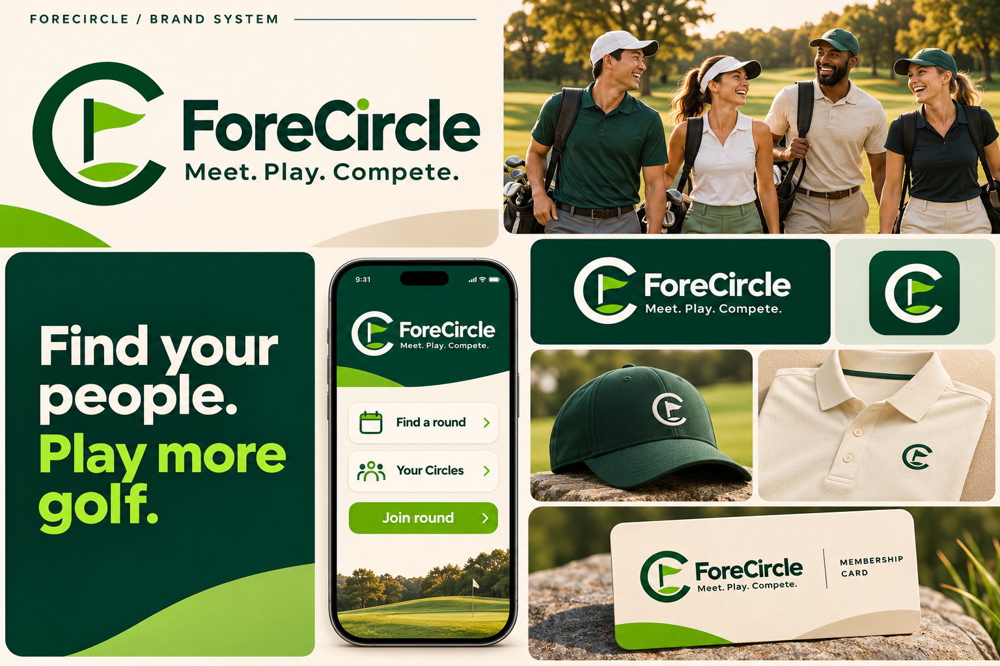

# ForeCircle

**Meet. Play. Compete.**

Find your people. Play more golf.

ForeCircle is a social golf community for meeting golfers, finding open rounds, creating Circles, organizing events, and competing together.

- Primary domain: **ForeCircleGolf.com**
- App domain: **ForeCircle.app**
- Current brand direction: **Refined Original** - the forest-green circle, golf flag, and putting-green emblem.

## Brand files

| File | Purpose |
| --- | --- |
| [Brand guide](branding/ForeCircle_Brand_Guide.pdf) | Seven-page palette, logo, typography, interface, and application guide |
| [Complete brand kit](branding/ForeCircle_Brand_Kit.zip) | Downloadable package of the guide and reusable assets |
| [Transparent logo](branding/ForeCircle_Logo_Transparent.png) | Horizontal PNG logo with tagline |
| [Brand applications](branding/ForeCircle_Brand_Applications.png) | App, apparel, membership-card, and photography concepts |
| [CSS tokens](branding/ForeCircle_Tokens.css) | Colors, fonts, semantic roles, and example button styles |
| [JSON tokens](branding/ForeCircle_Tokens.json) | Machine-readable design settings |
| [Palette CSV](branding/ForeCircle_Palette.csv) | Core hex/RGB colors and usage |
| [Fonts and licenses](branding/fonts/) | Manrope and Inter variable fonts with license notices |
| [Selected concept reference](branding/reference/ForeCircle_Refined_Original.png) | Refined Original concept that anchors this identity |
| [Brand notes](branding/README.md) | Asset details, contrast rules, and production notes |
| [Cursor handoff](docs/CURSOR_BRANDING_HANDOFF.md) | Instructions for applying this identity to future product work |

## Core palette

| Color | Hex | Use |
| --- | --- | --- |
| Forest | `#003D29` | Identity, navigation, primary buttons |
| Fairway | `#65B800` | Flag, active accents, highlights |
| Ivory | `#FFF8EE` | Main background and stationery |
| Sage | `#E8F0E8` | Quiet panels and alternate sections |
| Sand | `#D7CBB8` | Warm editorial accents |
| Charcoal | `#182C24` | Body copy and text on bright green |

Use **Manrope 700-800** for headings and **Inter 400-700** for body copy and interface labels. Keep the supplied wordmark as artwork rather than retyping it.

The exact token values take precedence over colors sampled from generated previews. Use ivory text on forest-green buttons and charcoal text on bright-green buttons.

## Repository status

This initial repository contains brand assets and implementation guidance. The application mockups are visual concepts; they are not screenshots of a deployed or implemented product. The supplied logo is raster PNG artwork. Vector, emblem-only, print separation, and embroidery files remain production follow-ups.

See [branding/SHA256SUMS.txt](branding/SHA256SUMS.txt) for asset integrity checks. The ZIP is the original downloadable kit; the selected-reference image and repository handoff are also available separately in this repository.
